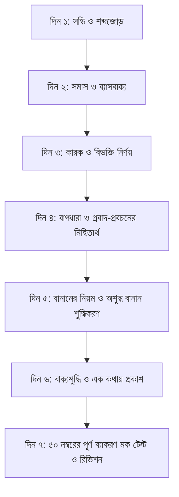

# ১৭ · বাংলা ব্যাকরণ: NCTB ৯ম-দশম শ্রেণি (২০২৬ সংস্করণ) পৃষ্ঠা ম্যাপিং, টেক্সট নোটস ও পূর্ণাঙ্গ প্রস্তুতি পাইপলাইন

> **লক্ষ্য পদ:** বাংলাদেশ ব্যাংক ও সমন্বিত ৯ ব্যাংক/আর্থিক প্রতিষ্ঠান — সিনিয়র অফিসার (SO) লিখিত পরীক্ষা  
> **নম্বর:** বাংলা ব্যাকরণ (১০ নম্বর)  
> **অফিসিয়াল সিলেবাস:** বানান/বানানের নিয়ম, বাক্যশুদ্ধি, প্রবাদ-প্রবচনের নিহিতার্থ প্রকাশ, কারক, সমাস, সন্ধি বিচ্ছেদ, এক কথায় প্রকাশ ও প্রায় সমোচ্চারিত ভিন্নার্থক শব্দ।  
> **মূল উৎস বই:** `Bangla/Secondary (BV)-2026_Class 9-10_Bangla Grammar_compressed.pdf` (জাতীয় শিক্ষাক্রম ও পাঠ্যপুস্তক বোর্ড, বাংলাদেশ — পরিমার্জিত শিক্ষাক্রম সংস্করণ ২০২৬)
>
> ⚠️ **২২ নভেম্বর ২০২৬ স্ট্রেস-টেস্টের পর:** এই ফাইলটি শুধু NCTB বইয়ের পৃষ্ঠা খোঁজার জন্য রাখা হয়েছে। পরীক্ষার মূল প্রস্তুতি এখন **[docs/18_bangla_grammar_fullmarks.md](18_bangla_grammar_fullmarks.md)**-এ। সেখানে আছে বাচ্য ও লিঙ্গ (জুন ২০২৬-এর প্রশ্নে ৪ নম্বর এসেছিল), NCTB আর প্রথাগত ব্যাকরণের দুই মত মিলিয়ে উত্তর লেখার নিয়ম (সম্প্রদান কারক ইত্যাদি), যাচাই করা পূর্ণ তালিকা আর মক টেস্ট। এই ফাইলের ভুলগুলোও নিচে সংশোধন করা হয়েছে।

---

## ১. বইটির পৃষ্ঠা ও PDF পৃষ্ঠার নির্ভুল সম্পর্ক (Precision Mapping)

বইটির সূচিপত্র রয়েছে **PDF পৃষ্ঠা ৫**-এ। বইয়ের প্রথম অধ্যায়ের ১ নম্বর পৃষ্ঠা শুরু হয়েছে **PDF পৃষ্ঠা ৬** থেকে।  
সুতরাং গণনার সূত্র:  
$$\text{PDF পৃষ্ঠা} = \text{বইয়ের মুদ্রিত পৃষ্ঠা} + ৫$$

### সিলেবাসের টপিক অনুযায়ী নির্দিষ্ট পৃষ্ঠা তালিকা:

| ক্রম | সিলেবাসের টপিক | বইয়ের পরিচ্ছেদ ও শিরোনাম | বইয়ের মুদ্রিত পৃষ্ঠা | PDF পৃষ্ঠার সঠিক নম্বর | কভারেজ স্থিতি |
|:---:|---|---|:---:|:---:|:---:|
| **১** | **সমাস** | পরিচ্ছেদ ১২: সমাস প্রক্রিয়ায় শব্দ গঠন | **৩৭ – ৪০** | **৪২ – ৪৫** | বইটিতে ১০০% সম্পূর্ণ |
| **২** | **সন্ধি বিচ্ছেদ** | পরিচ্ছেদ ১৩: সন্ধি | **৪১ – ৪৩** | **৪৬ – ৪৮** | বইটিতে ১০০% সম্পূর্ণ |
| **৩** | **কারক** | পরিচ্ছেদ ৩৫: কারক | **৯৫ – ৯৭** | **১০০ – ১০২** | বইটিতে ১০০% সম্পূর্ণ |
| — | *(কারক সহায়ক)* **বিভক্তি** | পরিচ্ছেদ ২৮: বিভক্তি | **৭৪ – ৭৫** | **৭৯ – ৮০** | কারক নির্ণয়ের ভিত্তি |
| **৪** | **প্রায় সমোচ্চারিত ভিন্নার্থক শব্দ** | পরিচ্ছেদ ৪৩: শব্দজোড় | **১২১ – ১২৫** | **১২৬ – ১৩০** | বইটিতে ১০০% সম্পূর্ণ (১১০+ জোড়া) |
| **৫** | **প্রবাদ-প্রবচন ও বাগধারা** | পরিচ্ছেদ ৪০: বাগধারা | **১০৯ – ১১৩** | **১১৪ – ১১৮** | বইটিতে ১০০% সম্পূর্ণ (নিহিতার্থসহ) |
| — | *(শব্দার্থ ও নিহিতার্থ সহায়ক)* | পরিচ্ছেদ ৩৯: বাগর্থ | **১০৬ – ১০৮** | **১১১ – ১১৩** | শব্দের গূঢ়ার্থ ও সমার্থকতা |
| **৬** | **বানান / বানানের নিয়ম** | পরিচ্ছেদ ৫: ধ্বনি ও বর্ণ<br>পরিচ্ছেদ ৮: বর্ণের উচ্চারণ ও বানান প্রভাব<br>পরিচ্ছেদ ১০ ও ১১: উপসর্গ ও প্রত্যয় | **১২ – ১৪**<br>**২৩ – ২৫**<br>**২৯ – ৩৬** | **১৭ – ১৯**<br>**২৮ – ৩০**<br>**৩৪ – ৪১** | আংশিক তাত্ত্বিক (বাকিটা সাপ্লিমেন্ট থেকে) |
| **৭** | **বাক্যশুদ্ধি (বাক্যতত্ত্ব)** | পরিচ্ছেদ ৩১: বাক্যের অংশ ও শ্রেণিবিভাগ<br>পরিচ্ছেদ ৩২–৩৪: উদ্দেশ্য-বিধেয় ও বাক্য গঠন<br>পরিচ্ছেদ ৩৮: যতিচিহ্ন | **৮৩ – ৮৫**<br>**৮৬ – ৯৪**<br>**১০৩ – ১০৫** | **৮৮ – ৯০**<br>**৯১ – ৯৯**<br>**১০৮ – ১১০** | গঠন ও যতিচিহ্ন আছে; অপপ্রয়োগ তালিকা আলাদা |
| **৮** | **এক কথায় প্রকাশ** | *এই সংস্করণে নেই* (পুরাতন সংস্করণে ছিল) | — | — | **সাপ্লিমেন্টারি পাইপলাইন থেকে পড়তে হবে** |

> ⚠️ **গুরুত্বপূর্ণ পর্যবেক্ষণ:**  
> NCTB-র এই নতুন ২০২৬ পরিমার্জিত সংস্করণে ব্যাকরণকে আধুনিক ভাষাতাত্ত্বিক পদ্ধতিতে সাজানো হয়েছে। এর ফলে **সমাস, সন্ধি, কারক, শব্দজোড় ও বাগধারা** বইটিতে সরাসরি থাকলেও **এক কথায় প্রকাশ** বাদ দেওয়া হয়েছে এবং **বানানের নিয়মাবলী ও বাক্য অপপ্রয়োগের ক্লাসিক অশুদ্ধ→শুদ্ধ তালিকা** সংকুচিত করা হয়েছে। ব্যাংক পরীক্ষার লিখিত ১০ নম্বরের জন্য নিচে এই বইয়ের মূল অংশ এবং ঘাটতি পূরণের সম্পূর্ণ ম্যাটেরিয়াল যুক্ত করা হলো।

---

## ২. বইটির মূল অধ্যায়গুলোর নির্যাস ও গুরুত্বপূর্ণ উদাহরণ (Extracted Core Notes)

### ক. সমাস প্রক্রিয়ায় শব্দ গঠন (বই পৃষ্ঠা ৩৭–৪০ · PDF ৪২–৪৫)
* **মূল বিষয়:** বাক্যের মধ্যে সম্পর্কিত একাধিক পদের এক পদে পরিণত হওয়ার নাম সমাস। সমস্তপদ, পূর্বপদ, পরপদ ও ব্যাসবাক্য।
* **চারটি মূল প্রকারভেদ:**
  1. **দ্বন্দ্ব সমাস (উভয় পদ প্রধান):** মা ও বাবা = মা-বাবা, জমা ও খরচ = জমাখরচ, ভালো ও মন্দ = ভালোমন্দ।  
     - *অলুক দ্বন্দ্ব:* হাতে ও কলমে = হাতে-কলমে, চোখে ও মুখে = চোখেমুখে, চলনে ও বলনে = চলনে-বলনে।  
     - *বহুপদী দ্বন্দ্ব:* সাহেব, বিবি ও গোলাম = সাহেব-বিবি-গোলাম।
  2. **কর্মধারয় সমাস (পরপদ প্রধান):** গোলাপ নামের ফুল = গোলাপফুল, যা কাঁচা তাই মিঠা = কাঁচা-মিঠা।  
     - *সাধারণ কর্মধারয় ('যে' যোজক):* খাস যে জমি = খাসজমি, চালাক সে চতুর = চালাকচতুর।  
     - *দ্বিগু কর্মধারয়:* তিন ফলের সমাহার = ত্রিফলা, চার রাস্তার মিলন = চৌরাস্তা।  
     - *মধ্যপদলোপী:* ঘি মাখানো ভাত = ঘিভাত, হাত পরার ঘড়ি = হাতঘড়ি, ঘর আশ্রিত জামাই = ঘরজামাই।  
     - *উপমান (সাধারণ গুণবাচক):* কাজলের মতো কালো = কাজলকালো, শশের মতো ব্যস্ত = শশব্যস্ত।  
     - *উপমিত (উপমেয় + উপমান):* পুরুষ সিংহের ন্যায় = সিংহপুরুষ, মুখ চন্দ্রের ন্যায় = চন্দ্রমুখ (NCTB-তে এভাবেই ছাপা)। **প্রথাগত ও পরীক্ষায় প্রচলিত রূপ: পুরুষসিংহ, মুখচন্দ্র, করকমল।** দুই মত মিলিয়ে উত্তর লেখার নিয়ম doc 18 §২-এ।  
     - *রূপক (অভেদ কল্পনা):* বিষাদ রূপ সিন্ধু = বিষাদসিন্ধু, মন রূপ মাঝি = মনমাঝি।
  3. **তৎপুরুষ সমাস (পরপদ প্রধান, বিভক্তি/অনুসর্গ লোপ):**  
     - *বিভক্তি লোপ:* দুঃখকে প্রাপ্ত = দুঃখপ্রাপ্ত, পথের রাজা = রাজপথ, গাছে পাকা = গাছপাকা, অকালে মৃত্যু = অকালমৃত্যু।  
     - *অনুসর্গ লোপ:* মধু দিয়ে মাখা = মধুমাখা, রান্নার জন্য ঘর = রান্নাঘর, গ্রাম থেকে ছাড়া = গ্রামছাড়া।  
     - *অলুক তৎপুরুষ:* গরুর গাড়ি = গরুরগাড়ি, তেলে ভাজা = তেলেভাজা।
  4. **বহুব্রীহি সমাস (অন্য অর্থ প্রধান):**  
     - *সমানাধিকার:* এক গোঁ যার = একগুঁয়ে, লাল পাড় যে শাড়ির = লালপেড়ে।  
     - *ব্যাধিকরণ:* গোঁফে খেজুর যার = গোঁফেখেজুরে।  
     - *পদলোপী:* চিরুনির মতো দাঁত যার = চিরুনদাঁতি, হাতে খড়ি দেওয়া হয় যে অনুষ্ঠানে = হাতেখড়ি।  
     - *ব্যতিহার (পারস্পরিক ক্রিয়া):* হাতে হাতে যে যুদ্ধ = হাতাহাতি, কানে কানে যে কথা = কানাকানি।  
     - *অলুক বহুব্রীহি:* গায়ে এসে পড়ে যে = গায়েপড়া, কানে খাটো যে = কানেখাটো।  
     - *সংখ্যাবাচক:* চার ভুজ যে ক্ষেত্রের = চতুর্ভুজ, সে (তিন) তার যে যন্ত্রের = সেতার।

---

### খ. সন্ধি বিচ্ছেদ (বই পৃষ্ঠা ৪১–৪৩ · PDF ৪৬–৪৮)
* **স্বরসন্ধি (নিয়ম ও উদাহরণ):**
  - অ/আ + অ/আ = আ: উত্তর + অধিকার = উত্তরাধিকার, আশা + অতীত = আশাতীত।
  - ই/ঈ + ই/ঈ = ঈ: অতি + ইন্দ্রিয় = অতীন্দ্রিয়, পরি + ঈক্ষা = পরীক্ষা।
  - উ/ঊ + উ/ঊ = ঊ: মরু + উদ্যান = মরূদ্যান।
  - অ/আ + ই/ঈ = এ: শুভ + ইচ্ছা = শুভেচ্ছা।
  - অ/আ + উ/ঊ = ও: সূর্য + উদয় = সূর্যোদয়।
  - অ/আ + ঋ = অর্: মহা + ঋষি = মহর্ষি।
  - অ/আ + এ/ঐ = ঐ: জন + এক = জনৈক।
  - অ/আ + ও/ঔ = ঔ: বন + ওষধি = বনৌষধি।
  - ই/ঈ + অন্য স্বর = য্-ফলা: প্রতি + এক = প্রত্যেক।
  - উ/ঊ + অন্য স্বর = ব্-ফলা: সু + অল্প = স্বল্প।
  - এ + অন্য স্বর = অয়্: শে + অন = শয়ন; ঐ + অন্য স্বর = আয়্: নৈ + অক = নায়ক।
  - ও + অন্য স্বর = অব্: গো + আদি = গবাদি; ঔ + অন্য স্বর = আব্: নৌ + ইক = নাবিক।
  - *নিপাতনে সিদ্ধ স্বরসন্ধি:* কুল + অটা = কুলটা, গো + অক্ষ = গবাক্ষ।
* **ব্যঞ্জনসন্ধি:**
  - স্বর+ব্যঞ্জন: কথা + ছলে = কথাচ্ছলে, পরি + ছেদ = পরিচ্ছেদ।
  - ব্যঞ্জন+স্বর: দিক্ + অন্ত = দিগন্ত, সৎ + উপায় = সদুপায়।
  - ব্যঞ্জন+ব্যঞ্জন: চলৎ + চিত্র = চলচ্চিত্র, বিপদ + জনক = বিপজ্জনক, উৎ + লাস = উল্লাস, বাক্ + দান = বাগদান, তৎ + মধ্যে = তন্মধ্যে, সম্ + তাপ = সন্তাপ, সম্ + মান = সম্মান।
  - *নিপাতনে সিদ্ধ ব্যঞ্জনসন্ধি:* গো + পদ = গোষ্পদ, এক + দশ = একাদশ, বৃহৎ + পতি = বৃহস্পতি।
* **বিসর্গসন্ধি:**
  - বিসর্গ অপরিবর্তিত: মনঃ + কষ্ট = মনঃকষ্ট, অধঃ + পতন = অধঃপতন, বয়ঃ + সন্ধি = বয়ঃসন্ধি।
  - বিসর্গ 'ও' হয়: মনঃ + যোগ = মনোযোগ, তিরঃ + ধান = তিরোধান, তপঃ + বন = তপোবন।
  - বিসর্গ 'র্' হয়: নিঃ + আকার = নিরাকার, পুনঃ + মিলন = পুনর্মিলন, আশীঃ + বাদ = আশীর্বাদ।
  - বিসর্গ শ/ষ/স হয়: নিঃ + চয় = নিশ্চয়, দুঃ + কর = দুষ্কর, পুরঃ + কার = পুরস্কার।
  - পূর্ব স্বর দীর্ঘ: নিঃ + রব = নীরব, নিঃ + রস = নীরস, নিঃ + রোগ = নীরোগ।

---

### গ. কারক ও বিভক্তি (বই পৃষ্ঠা ৯৫–৯৭, ৭৪–৭৫ · PDF ১০০–১০২, ৭৯–৮০)
* **বিভক্তির রূপ:** প্রথমা/শূন্য (অ), দ্বিতীয়া (কে, রে), তৃতীয়া (দ্বারা, দিয়া, কর্তৃক), চতুর্থী (কে, জন্য), পঞ্চমী (হতে, থেকে, চেয়ে), ষষ্ঠী (র, এর), সপ্তমী (এ, য়, তে)।
* ⚠️ **NCTB ২০২৬ বইয়ে সম্প্রদান কারক নেই, তার জায়গায় সম্বন্ধ কারক।** প্রথাগত ব্যাকরণে (যা বেশিরভাগ পরীক্ষক মানেন) সম্প্রদান আছে, আর সম্বন্ধ কারক হিসেবে গণ্য নয়। খাতায় দুই মতই লিখুন, যেমন: "ভিক্ষুককে = সম্প্রদানে ৪র্থী (NCTB মতে কর্ম)"। নিয়মটি doc 18 §২-এ।
* **কারকের ৬ প্রকারভেদ (NCTB) ও ব্যাংক পরীক্ষার চেনার উপায়:**
  1. **কর্তা কারক (কে/কারা করে):** আমরা নদীর ঘাট থেকে রিকশা নিয়েছিলাম (আমরা = কর্তা)। *ছাগলে কিনা খায়* (ছাগলে = কর্তায় ৭মী)।
  2. **কর্ম কারক (কী/কাকে করে):** সে রোজ সকালে এক প্লেট *ভাত* খায় (ভাত = কর্মে শূন্য)। *শিক্ষককে* জানাও (শিক্ষককে = কর্মে ২য়া)। কাব্যে: *আমারে* তুমি করিবে ত্রাণ (আমারে = কর্মে ২য়া)।
  3. **করণ কারক (উপায়/যন্ত্র/উপকরণ):** ভেড়া দিয়ে চাষ করা সম্ভব নয় (ভেড়া দিয়ে = করণে তৃতীয়া)। চাষিরা *ধারালো কাস্তে দিয়ে* ধান কাটছে।
  4. **অপাদান কারক (উৎস, চ্যুত, ভীত, গৃহীত, শুরু):** *জমি থেকে* ফসল পাই (জমি থেকে = অপাদানে ৫মী)। কাপটা *উঁচু টেবিল থেকে* পড়ে ভেঙে গেল।
  5. **অধিকরণ কারক (স্থান, কাল, বিষয়, ভাব):** বাবা *বাড়িতে* আছেন (স্থান = অধিকরণে ৭মী)। বিকাল *পাঁচটায়* অফিস ছুটি হবে (কাল = অধিকরণে ৭মী)। রাজীব *বাংলা ব্যাকরণে* ভালো (বিষয় = অধিকরণে ৭মী)।
  6. **সম্বন্ধ কারক (ক্রিয়ার সাথে পরোক্ষ, বিশেষ্য-সর্বনামের র/এর সম্বন্ধ):** *ফুলের* গন্ধে ঘুম আসে না (ফুলের = সম্বন্ধ পদে ষষ্ঠী)। *আমার* জামার বোতামগুলো একটু অন্য রকম।

---

### ঘ. প্রায় সমোচ্চারিত ভিন্নার্থক শব্দ / শব্দজোড় (বই পৃষ্ঠা ১২১–১২৫ · PDF ১২৬–১৩০)
ব্যাংক পরীক্ষায় এর থেকে সরাসরি অর্থ পার্থক্য ও বাক্য রচনা আসে। বইয়ের নির্বাচিত গুরুত্বপূর্ণ জোড়া:
* **অকুল** (নীচ বংশ) — **অকূল** (কূলহীন/সীমাহীন): অকূল পাথারে তিনি দিশেহারা।
* **অণু** (পদার্থের ক্ষুদ্রতম অংশ) — **অনু** (পশ্চাৎ/সদৃশ): বিজ্ঞান শিক্ষক অণুর গঠন ব্যাখ্যা করলেন।
* **অনিষ্ট** (ক্ষতি) — **অনিষ্ঠ** (নিষ্ঠাহীন): কারও অনিষ্ট চিন্তা করা পাপ।
* **অন্ত্য** (শেষ) — **অন্তঃ** (ভিতর): তিনি অন্ত্যবর্ণের উচ্চারণ শেখালেন।
* **অন্ন** (ভাত) — **অন্য** (অপর): অন্ন সংস্থানে মানুষ দিনরাত পরিশ্রম করে।
* **অপদার্থ** (অযোগ্য) — **অপাঙক্তেয়** (সমাজে স্থানহীন): তাকে অপদার্থ ভেবে দূরে ঠেলে দিও না।
* **উপাদান** (উপকরণ) — **উপাধান** (বালিশ): তুলো হলো উপাধানের প্রধান উপাদান।
* **ওষধি** (একবার ফল দিয়ে মরে যে গাছ) — **ঔষধি** (ভেষজ উদ্ভিদ): ধান ও গম হলো ওষধি গাছ।
* **কটি** (কোমর) — **কোটি** (শত লক্ষ): নদী ভাঙনে কোটি টাকার ক্ষয়ক্ষতি হয়েছে।
* **কড়া** (আংটা/কঠোর) — **করা** (সম্পাদন): অন্যায় কাজের বিরুদ্ধে কড়া ব্যবস্থা করা প্রয়োজন।
* **কুজন** (খারাপ লোক) — **কূজন** (পাখির ডাক): ভোরে পাখির সুমধুর কূজন শোনা যায়।
* **চির** (চিরকাল/চিরন্তন) — **চীর** (ছেঁড়া কাপড়): সন্ন্যাসী চীরবস্ত্র পরিধান করে আছেন।
* **দিন** (দিবস) — **দীন** (দরিদ্র): তিনি দীন-দরিদ্রের মাঝে খাদ্য বিতরণ করলেন।
* **দ্বীপ** (চারদিকে জলবেষ্টিত স্থল) — **দীপ** (প্রদীপ): সন্ধেবেলা মন্দিরে দীপ জ্বালানো হলো।
* **পড়া** (পাঠ করা/পতিত হওয়া) — **পরা** (পরিধান করা): নতুন জামা পরে ছেলেটি স্কুলে গেল।
* **বিনা** (ব্যতীত) — **বীণা** (বাদ্যযন্ত্র): চেষ্টা বিনা কোনো কাজে সফলতা আসে না।
* **স্বর্গ** (দেবলোক) — **সর্গ** (গ্রন্থের অধ্যায়): মহাকাব্যের তৃতীয় সর্গে যুদ্ধের বর্ণনা আছে।

---

### ঙ. প্রবাদ-প্রবচন ও বাগধারা (বই পৃষ্ঠা ১০৯–১১৩ · PDF ১১৪–১১৮)
পরীক্ষায় ব্যাসবাক্যের মতো বাগধারার নিহিতার্থ ব্যাখ্যা করে বাক্য রচনা করতে হয়:
* **অক্কা পাওয়া** (মারা যাওয়া): মাতব্বর অবশেষে অক্কা পেয়েছে।
* **অদৃষ্টের পরিহাস** (ভাগ্যের নির্মম খেলা): ধনী ব্যক্তিটির আজ ভিক্ষা করা অদৃষ্টের পরিহাস মাত্র।
* **অন্ধের যষ্টি** (একমাত্র অবলম্বন): বিধবা মায়ের একমাত্র ছেলেটি অন্ধের যষ্টি।
* **অমাবস্যার চাঁদ** (দুর্লভ বস্তু): চাকরি পাওয়ার পর তোমার দেখা পাওয়াই ভার, যেন অমাবস্যার চাঁদ!
* **আষাঢ়ে গল্প** (আজগুবি গল্প): তোমার এই আষাঢ়ে গল্প কেউ বিশ্বাস করবে না।
* **উড়নচণ্ডী** (বেহিসাবি/উচ্ছন্নে যাওয়া): উড়নচণ্ডী ছেলের হাতে টাকা দিলে সব ধ্বংস হবে।
* **কলমের খোঁচা** (লেখার মাধ্যমে অনিষ্ট বা ক্ষতি সাধন): কর্তার এক কলমের খোঁচায় নিরীহ কেরানির চাকরি গেল।
* **গড্ডলিকা প্রবাহ** (অন্ধ অনুকরণ): নিজের বুদ্ধি বিবেচনা না খাটিয়ে গড্ডলিকা প্রবাহে গা ভাসিয়ো না।
* **ডুমুরের ফুল** (অদৃশ্য বস্তু): আজকাল তোমার কোনো খোঁজ নেই, একেবারেই ডুমুরের ফুল হয়ে গেছ।
* **তালকানা** (কাণ্ডজ্ঞানহীন): এমন তালকানা লোককে হিসাবের দায়িত্ব দেওয়া বোকামি।
* **দহরম-মহরম** (ঘনিষ্ঠ সম্পর্ক): প্রতিবেশীদের সঙ্গে এমন দহরম-মহরম সম্পর্কই কাম্য।
* **বিলের মাছ তোলা** (সহজে অন্যের সম্পত্তি আত্মসাৎ): গরিবের জমি কেড়ে নেওয়া যেন বিলের মাছ তোলা।
* **শকুনি মামা** (কুচক্রী লোক): পরিবারের মধ্যে এমন শকুনি মামা থাকলে শান্তি নষ্ট হয়।
* **হাতি-ঘোড়া গেল তল, মশা বলে কত জল** (অযোগ্যের আস্ফালন): অভিজ্ঞ অফিসার সমাধান করতে পারল না, আর শিক্ষানবিস বলে এটা কোনো ব্যাপারই না!

---

## ৩. ঘাটতি পূরণ: বইয়ে যা নেই এবং ব্যাংক পরীক্ষার জন্য অত্যাবশ্যক

### ১. বাংলা একাডেমি প্রমিত বানানের নিয়ম (৫টি নিশ্চিত নিয়ম)
1. **তৎসম শব্দের ণত্ব-ষত্ব বিধান:** ঋ, র, ষ-এর পর ণ এবং ষ হয় (ঋণ, বর্ণ, ভাষণ)। ট-বর্গের পূর্বে মূর্ধন্য-ণ হয় (ঘণ্টা, বণ্টন, লুণ্ঠন)। কিন্তু তদ্ভব, দেশি ও বিদেশি শব্দে কখনোই 'ণ' বা 'ষ' হবে না (কোরআন, গভর্নর, স্টেশন, পোস্ট)।
2. **ই-কার ব্যবহারের নিয়ম:** সকল অতৎসম (তদ্ভব, দেশি, বিদেশি ও মিশ্র) শব্দে কেবল হ্রস্ব ই-কার (ি) ব্যবহৃত হবে। যেমন: সরকারি, তরকারি, চাকরি, আরবি, ফারসি, ডিগ্রি, কোম্পানি, একাডেমি। *(শ্রেণি অতৎসম নয়, তৎসম শব্দ। এটি আলাদা নিয়মে ই-কার পায়: যেসব তৎসম শব্দে ই ও ঈ দুটোই শুদ্ধ, সেখানে ই-কার লেখা হয়। যেমন শ্রেণি, পদবি, পল্লি।)*
3. **স্ত্রীবাচক অতৎসম শব্দ:** অতৎসম স্ত্রীবাচক শব্দেও কেবল হ্রস্ব ই-কার হবে। যেমন: নানি, দাদি, মাসি, পিসি, চাচি, পাগলি, ছুঁড়ি।
4. **-আলি প্রত্যয়যুক্ত শব্দ:** শব্দের শেষে '-আলি' প্রত্যয় থাকলে হ্রস্ব ই-কার হবে। যেমন: মিতালি, সোনালি, রূপালি, বর্ণালি, খেয়ালি।
5. **রেফের পর দ্বিত্ব নয়:** শব্দের বানানে রেফের পর কোনো ব্যঞ্জনবর্ণের দ্বিত্ব রূপ হবে না। যেমন: কার্য্য নয় **কার্য**, সূর্য্য নয় **সূর্য**, অর্জ্জন নয় **অর্জন**, অর্চ্চনা নয় **অর্চনা**, ধর্ম্ম নয় **ধর্ম**।

### ২. ব্যাংক লিখিত পরীক্ষায় বারবার আসা বাক্যশুদ্ধি (নির্বাচিত ১২টি; যাচাই করা পূর্ণ ৫০টি doc 18 §৪.৮-এ)
| অশুদ্ধ রূপ | শুদ্ধ রূপ | ভুলের কারণ |
|---|---|---|
| তিনি স্বস্ত্রীক উপস্থিত ছিলেন। | তিনি **সস্ত্রীক** উপস্থিত ছিলেন। | 'স্ব' মানে নিজ, 'স' মানে সহিত |
| সকল ছাত্ররা উপস্থিত ছিল। | **সকল ছাত্র** / **ছাত্ররা** উপস্থিত ছিল। | বাহুল্য দোষ (দ্বৈত বহুবচন) |
| তার দারিদ্রতা দেখে কষ্ট হয়। | তার **দারিদ্র্য / দরিদ্রতা** দেখে কষ্ট হয়। | প্রত্যয়জনিত অশুদ্ধি (দারিদ্র্যতা নয়) |
| তার প্রতিভা দেখে আমি আশ্চর্যান্বিত হলাম। | তার প্রতিভা দেখে আমি **আশ্চর্য / চমৎকৃত** হলাম। | অপপ্রয়োগ |
| আকণ্ঠ পর্যন্ত ভোজন করা অনুচিত। | **আকণ্ঠ** ভোজন করা অনুচিত। | 'আ' উপসর্গেই 'পর্যন্ত' অর্থ আছে |
| সে অপমান হয়েছে। | সে **অপমানিত** হয়েছে। | বিশেষ্যের জায়গায় বিশেষণ ("অপমানিত" শুদ্ধ; আগের সংস্করণে এটিকে ভুলভাবে অশুদ্ধ বলা হয়েছিল) |
| উপরোক্ত বাক্যটি সঠিক নয়। | **উপর্যুক্ত / উপরিউক্ত** বাক্যটি সঠিক নয়। | সন্ধিজনিত বানান |
| আবশ্যকীয় দ্রব্যাদি ক্রয় করো। | **আবশ্যক** দ্রব্যাদি ক্রয় করো। | অপ্রয়োজনীয় প্রত্যয় |
| কেবলমাত্র তুমিই যেতে পারো। | **কেবল / মাত্র** তুমিই যেতে পারো। | বাহুল্য দোষ |
| ছেলেটি বিদ্যান কিন্তু অহঙ্কারী। | ছেলেটি **বিদ্বান** কিন্তু অহঙ্কারী। | বানান অশুদ্ধি |
| সেখানে অনাকাঙ্ক্ষিত ঘটনা ঘটিয়াছে। | সেখানে অনাকাঙ্ক্ষিত ঘটনা **ঘটেছে**। | সাধু-চলিতের গুরুচণ্ডালী দোষ |
| তিনি মোকদ্দমায় স্বাক্ষী দিয়েছেন। | তিনি মোকদ্দমায় **সাক্ষ্য** দিয়েছেন। | ব্যক্তি 'সাক্ষী', কাজ 'সাক্ষ্য' |

### ৩. ব্যাংকে আসা এক কথায় প্রকাশ (নির্বাচিত ১৫টি; পূর্ণ ৮০টি doc 18 §৪.৬-এ)
1. যা সহজে অতিক্রম করা যায় না — **দুরতিক্রম্য**
2. যা পূর্বে দেখা যায়নি — **অদৃষ্টপূর্ব**
3. যা সহজে জানা যায় না — **দুর্জ্ঞেয়**
4. যা চিরস্থায়ী নয় — **নশ্বর** (যা ক্ষণকাল স্থায়ী — ক্ষণস্থায়ী)
5. যা অপনোদন করা কষ্টকর — **দুরপনেয়**
6. উপকারীর উপকার স্বীকার করে যে — **কৃতজ্ঞ** (উপকার স্বীকার করে না — অকৃতজ্ঞ; উপকারীর অপকার করে — কৃতঘ্ন)
7. যা জলে ও স্থলে চরে — **উভচর**
8. যা নিবারণ করা যায় না — **অনিবার্য**
9. লাভ করার ইচ্ছা — **লিপ্সা** (জয় করার ইচ্ছা — জিগীষা; জানার ইচ্ছা — জিজ্ঞাসা; বেঁচে থাকার ইচ্ছা — জিজীবিষা)
10. চোখের নিমেষে — **নিমেষে / পলকে**
11. একই সময়ে বর্তমান — **সমসাময়িক**
12. যা বলা হয়নি — **অনুক্ত**
13. যা পূর্বে শোনা যায়নি — **অশ্রুতপূর্ব**
14. যিনি ব্যাকরণ জানেন — **বৈয়াকরণ**
15. ফল পাকলে যে গাছ মারা যায় — **ওষধি**

---

## ৪. বাংলা ব্যাকরণ (১০ নম্বর) মাস্টার প্রস্তুতি পাইপলাইন (৭ দিনের নিখুঁত রুটিন)

পরীক্ষার হলে ১০ মিনিটে ১০ নম্বর শতভাগ নিশ্চিত করতে নিচের পাইপলাইনটি অনুসরণ করুন:



### দৈনিক কাজের তালিকা:
* **দিন ১ (সন্ধি + শব্দজোড়):** বইয়ের PDF পৃষ্ঠা **৪৬–৪৮** এবং **১২৬–১৩০** পড়ুন। শব্দজোড়গুলোর অর্থ দিয়ে খাতায় দুটি করে বাক্য তৈরি করুন।
* **দিন ২ (সমাস):** বইয়ের PDF পৃষ্ঠা **৪২–৪৫** পড়ুন। ব্যাসবাক্য করার সময় পূর্বপদ ও পরপদের অর্থের সম্পর্ক খেয়াল করুন (বিশেষ করে মধ্যপদলোপী ও বহুব্রীহি)।
* **দিন ৩ (কারক ও বিভক্তি):** বইয়ের PDF পৃষ্ঠা **৭৯–৮০** (বিভক্তি) ও **১০০–১০২** (কারক) সমাধান করুন। অনুসর্গভিত্তিক কারক (দিয়ে, হতে, থেকে) চিহ্নিত করুন।
* **দিন ৪ (বাগধারা ও প্রবাদ):** বইয়ের PDF পৃষ্ঠা **১১৪–১১৮** পড়ুন। শুধু অর্থ নয়, নিহিতার্থ উল্লেখ করে সাম্প্রতিক সমসাময়িক প্রেক্ষাপটে ১টি করে বাক্য লিখুন।
* **দিন ৫ (বানান ও নিয়ম):** বাংলা একাডেমির ৫টি প্রমিত নিয়ম মুখস্থ করুন। [docs/09_grammar_quick.md](09_grammar_quick.md) আর [docs/18](18_bangla_grammar_fullmarks.md) §৪.৭-এর বানান তালিকা খাতায় না দেখে বানান চর্চা করুন।
* **দিন ৬ (বাক্যশুদ্ধি ও সংকোচন):** বাহুল্য দোষ, প্রত্যয়জনিত ভুল এবং সাধু-চলিতের মিশ্রণযুক্ত ২০টি বিগত প্রশ্ন সমাধান করুন।
* **দিন ৭ (মক টেস্ট):** ওয়েব অ্যাপের **"বাংলা MCQ ও কুইজ"** এবং মডেল টেস্ট দিন:
  ```bash
  python engine/so.py quiz --sec bn
  ```
