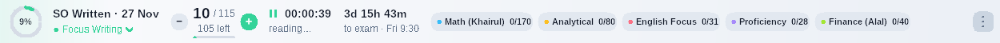

# SO Sprint Widget (Windows 11)

পড়ার সময় স্ক্রিনের ওপরে ভেসে থাকা ছোট একটি উইজেট। কত পৃষ্ঠা পড়লেন, লক্ষ্য কত, কত বাকি, কত সময় পড়ছেন, কোন গতিতে পড়ছেন আর পরীক্ষার কত সময় বাকি, সব এক লাইনে দেখায়।




## চালানো
1. `dist/SOSprintWidget.exe` ডাউনলোড করুন। একটাই ফাইল, ইনস্টল করতে হয় না।
2. দুই ক্লিক করুন। Windows "SmartScreen" সতর্কতা দেখালে **More info → Run anyway** চাপুন। ফাইলটা ডিজিটালি সাইন করা নয়, তাই এই সতর্কতা আসে।
3. উইজেটটি স্ক্রিনের ওপরের মাঝখানে আসবে আর সব উইন্ডোর ওপরে থাকবে।

## ব্যবহার
| কাজ | কীভাবে |
|---|---|
| পৃষ্ঠা যোগ বা বিয়োগ | **+ / −** বোতাম, অথবা সংখ্যার ওপর মাউস হুইল। Shift চেপে রাখলে ±৫ |
| নির্দিষ্ট পৃষ্ঠা লেখা | বড় সংখ্যায় ক্লিক → পৃষ্ঠা লিখে Enter |
| লক্ষ্য ঠিক করা | "/ লক্ষ্য" অংশে ক্লিক |
| ক্যাটাগরি বদলানো | ক্যাটাগরির নামে ক্লিক বা হুইল; চওড়া করলে ডানে প্রতিটি ক্যাটাগরির চিপ দেখা যায়, চিপে ক্লিক করুন |
| টাইমার | টাইমারে ক্লিক করলে চালু বা বিরতি। ৫ মিনিট পর পড়ার গতি (পৃষ্ঠা/ঘণ্টা) আর কখন শেষ হবে তা দেখায় |
| সরানো | ফাঁকা জায়গা বা রিং ধরে টেনে নিন |
| চওড়া করা | বাঁ বা ডান কিনারা টেনে নিন (শুধু পাশে বাড়ে, উচ্চতা একই থাকে) |
| পুরোটা বড় বা ছোট করা | Ctrl চেপে মাউস হুইল |
| আরও অপশন | ডান-ক্লিক বা ⋮: থিম (Midnight, Ocean, Plum, Paper), স্বচ্ছতা, ক্যাটাগরি যোগ/নাম বদল/মোছা, শিরোনাম, Windows চালু হলে নিজে চালু, ট্রেতে লুকানো |

- **পিডিএফ থেকে ফোকাস সরে না:** উইজেটে ক্লিক করলেও কিবোর্ড আপনার PDF রিডারেই থাকে।
- **ডেটা থাকে:** `%APPDATA%\SOSprintWidget\settings.ini`-এ সব সংরক্ষিত, কম্পিউটার বন্ধ করলেও হারায় না।
- **শুরুর ক্যাটাগরি:** ৭৭ ঘণ্টার প্ল্যানের লক্ষ্য দিয়ে আগে থেকে সাজানো: Focus Writing ১১৫, Math ১৭০, Analytical ৮০, English Focus ৩১, Proficiency ২৮, Finance ৪০, Translation ১৮, GK ১৯।

## নিজে বিল্ড করা (Linux)
```bash
sudo apt install g++-mingw-w64-x86-64-posix
./build.sh
```
Native Win32 + GDI+, সব কিছু স্ট্যাটিক লিংক করা; শুধু Windows-এর নিজস্ব DLL লাগে। Windows 11-এর গোল কোনা ও ছায়া DWM থেকে আসে।
